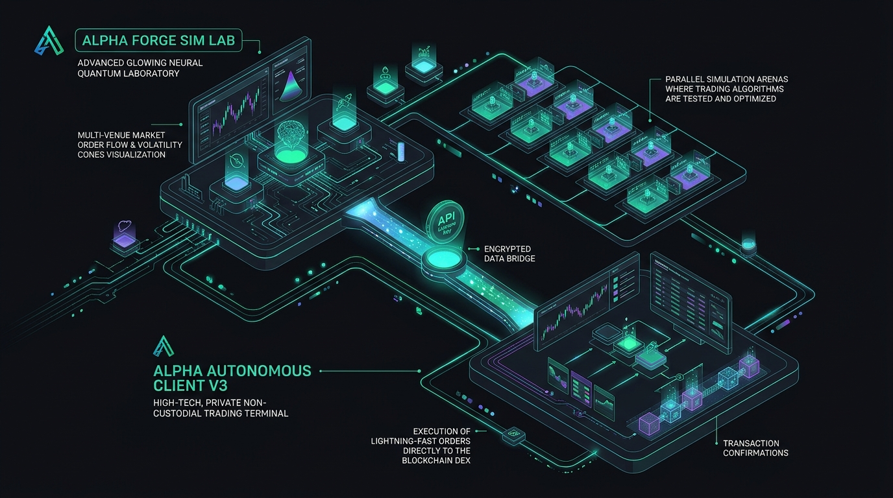
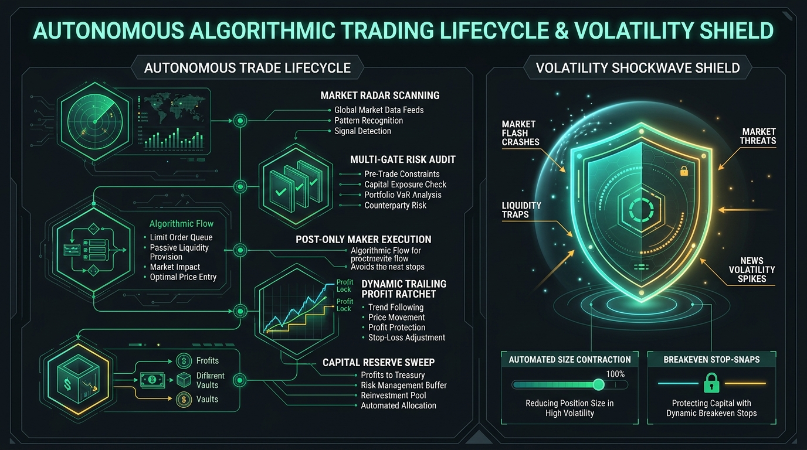
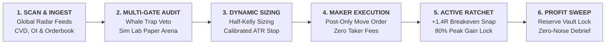

# Alpha Autonomous Client V3 (Decibel DEX • Aptos Mainnet)

[](https://aptoslabs.com)
[](https://decibel.exchange)
[](https://nodejs.org)
[](https://www.docker.com/)
[](LICENSE)

> **Next-generation autonomous perpetual futures trading client for Decibel DEX on Aptos.**  
> Powered by **Alpha Forge Sim Lab** quantitative intelligence via secure License API Key streaming. 100% Non-Custodial, zero-dependency on-chain Move order execution, 4-stage pre-trade risk sentinels, autonomous trailing profit harvesting, and a 1-minute browser onboarding wizard.

---

```
  ┌────────────────────────────────────────────────────────────────────────┐
  │                           EXECUTIVE OVERVIEW                           │
  │                                                                        │
  │  Target Product   : Alpha Autonomous Client V3                         │
  │  Intelligence Hub : Alpha Forge Sim Lab (Cloud Quantitative Engine)    │
  │  Access Model     : License API Key (Direct Telemetry Stream)          │
  │  Execution Venue  : Decibel DEX • Aptos Mainnet                        │
  │  Custody Model    : 100% Non-Custodial (Your Wallet, Your Subaccount)  │
  └────────────────────────────────────────────────────────────────────────┘
```

---

## Executive Summary

**Alpha Autonomous Client V3** represents a paradigm shift in decentralized algorithmic trading. Designed specifically for quantitative funds, proprietary trading desks, and serious decentralized finance (DeFi) traders, Client V3 pairs **non-custodial on-chain execution speed** with the computational firepower of **Alpha Forge Sim Lab**—a high-frequency cloud research and simulation laboratory.

Traditional retail trading bots operate in a complete vacuum: they rely on lagged chart indicators, fail during sudden market regime shifts, and suffer catastrophic drawdowns from toxic order flow. Centralized hedge funds, conversely, demand full custody of your capital.

**Client V3 solves both problems simultaneously:**
1. **Zero Custody Risk:** You deploy Client V3 inside your own private environment (Docker container, private VPS, or dedicated local hardware). Your private keys, subaccounts, and collateral never leave your sovereign control.
2. **Institutional Quantitative Brain:** Through a cryptographically authenticated **License API Key**, your private Client V3 terminal links directly into **Alpha Forge Sim Lab**. Sim Lab continuously streams real-time macro regimes, multi-venue orderflow intelligence, parallel paper simulation vetoes, and dynamic risk parameters directly to your execution engine.

---

## 🏛️ Ecosystem Architecture

<p align="center">
  
  <br>
  <em>Figure 1: High-level architectural overview of the Alpha Forge Sim Lab quantitative core streaming intelligence through an encrypted License API Key bridge to sovereign Client V3 execution nodes on Aptos Mainnet.</em>
</p>

---

## 👥 Comprehensive Agent Fleet Organizational Structure (The Institutional Staff Hierarchy)

To provide total structural clarity into how the autonomous trading machinery operates without human fatigue or emotional bias, the fleet is organized into a disciplined **institutional quantitative trading firm hierarchy**. 

At the pinnacle sits the **Executive Agent Brain (Chief Investment Officer)**, which delegates all specialized analytical and tactical operations to **3 Subordinate Department Head Agents**. Each subordinate agent commands dedicated processing nodes and specialized background task workers. Together, they execute the **5 Pipeline Phases (Dimension 2)** and **6 Strategy Confluence Layers (Dimension 3)**, synthesizing live intelligence into encrypted **Alpha Bundles** that are broadcast to distributed, 100% non-custodial execution client nodes (Host 1, Host 2, Host X):

```
┌────────────────────────────────────────────────────────────────────────────────────────┐
│                                 TIER 1: AGENT BRAIN                                    │
│                 Chief Investment Officer (CIO) • Executive High Command                 │
│              Global Portfolio Mandate • Fleet Capital Allocation • Council Lead        │
└───────────────────────────────────────────┬────────────────────────────────────────────┘
                                            │ Directs Operational Departments
        ┌───────────────────────────────────┼───────────────────────────────────┐
        ▼                                   ▼                                   ▼
┌───────────────────────────────┐ ┌───────────────────────────────┐ ┌───────────────────────────────┐
│     SUBORDINATE AGENT 1       │ │     SUBORDINATE AGENT 2       │ │     SUBORDINATE AGENT 3       │
│   Macro & Global Liquidity    │ │ Quantitative Strategy &       │ │ Risk Sentinel, Treasury &     │
│           Sentinel            │ │ Confluence Officer            │ │ Harvest Master Officer        │
├───────────────────────────────┤ ├───────────────────────────────┤ ├───────────────────────────────┤
│ Nodes: Node 1 & Node 2        │ │ Nodes: Node 3 & Node 4        │ │ Nodes: Node 5, 6, 7 & Node 8  │
│ Workers: Ingestion, State     │ │ Workers: Indicator, Entropy,  │ │ Workers: Risk Gate, Executor, │
│ Machine, Cones, Freeze Worker │ │ SMC Invalidator, Debate Agent │ │ Harvester, Forensics Auditor  │
└───────────────┬───────────────┘ └───────────────┬───────────────┘ └───────────────┬───────────────┘
                │                                 │                                 │
                └─────────────────────────┬───────┴─────────────────────────────────┘
                                          ▼
┌────────────────────────────────────────────────────────────────────────────────────────┐
│                        TIER 2: THE INTEGRATED SIGNAL PIPELINE                          │
│                                                                                        │
│  Dimension 2: The 5 Pipeline Phases (End-to-End Signal Lifecycle)                      │
│    • Phase 1: Event-Driven Activity Bar Guard (Dollar/Volume Slices & T-1 Bar Guard)   │
│    • Phase 2: 6-Layer Modular Confluence Matrix Evaluation                             │
│        └─ Layer 0: Kronos Neural Foundation Trajectory (15-bar path)                   │
│        └─ Layer 1: Technical Indicators (RSI, EMAs, Volume Profile POC)                │
│        └─ Layer 2: Order Flow & Sweeps (CVD divergence, ΔOI, Entropy H, VPIN toxicity) │
│        └─ Layer 3: Smart Money Concepts (FVG, Order Blocks, Turtle Soup)               │
│        └─ Layer 4: AI Trap Shield (spoof walls, falling knives, chop H >= 0.995)       │
│        └─ Layer 5: Dynamic Harvest Master Engine (15m ATR & POC Volatility Snapping,   │
│                    Strict && Conjunction, +0.75% BE Snap, 3-bar Entropy Exhaustion)    │
│    • Phase 3: Dual-Model Adversarial Arbiter (Net EV >= 1.40x, Microstructure Veto)   │
│    • Phase 4: Risk Officer Pre-Execution Veto Node ($0.85 USD loss & leverage clamp)   │
│    • Phase 5: Alpha Bundle Dispatch (Maker post-only execution across fleet clients)   │
└───────────────────────────────────────────┬────────────────────────────────────────────┘
                                            │ Encrypted License API Stream (Zero Custody)
                                            ▼
┌────────────────────────────────────────────────────────────────────────────────────────┐
│                   TIER 3: MULTI-HOST CLIENT V3 NON-CUSTODIAL FLEET                     │
│               Sim Lab Feeds Market Intelligence Only • Keys Never Leave Host           │
├───────────────────────────────┬───────────────────────────────┬────────────────────────┤
│ HOST 1: Mainnet Client V1     │ HOST 2: Mainnet Client V3     │ HOST X: Sovereign Desk │
│ • Dedicated Execution Node    │ • Dedicated Execution Node    │ • Local Workstation/VPS│
│ • Aptos Subaccount A          │ • Aptos Subaccount B          │ • Aptos Subaccount C   │
│ • High-Speed Institutional    │ • Advanced Trailing Ratchets  │ • Independent Operator │
│ • 100% Non-Custodial Move     │ • 100% Non-Custodial Move     │ • 100% Non-Custodial   │
└───────────────────────────────┴───────────────────────────────┴────────────────────────┘
```

---

### 1. Detailed Breakdown: From Agent Brain to Nodes & Workers

#### 🧠 Tier 1: The Executive Agent Brain (Chief Investment Officer)
* **Who It Is:** The apex decision-maker governing overall fund objectives, global risk-on/risk-off postures, inter-agent consensus, and capital allocation across all asset classes.
* **Core Responsibilities:**
  1. **Mandate Formulation:** Balances long vs. short exposure across the entire fleet to prevent directional over-concentration.
  2. **Confidence Hurdle Calibration:** Dynamically commands the entry threshold (e.g. relaxing to 70% during strong macro trends, tightening to 85% during low-liquidity chop).
  3. **Departmental Governance:** Oversees the 3 subordinate agents below, reviewing real-time health telemetry and authorizing tactical overrides.

---

#### 👔 Tier 2: The 3 Subordinate Department Head Agents

#### **Subordinate Agent 1: Macro & Global Liquidity Sentinel (The Strategist)**
* **Persona & Role:** Chief Macro Strategist responsible for broad market climate, cross-venue capital flows, and macroeconomic risk sentinels.
* **Governed Nodes:**
  * **Node 1: Sim Lab Pipeline & Macro Directive Ingest (Sim Consumer & Supercharge Client)**:
    * *Ingestion Worker:* Streams real-time macro bundle updates every 15s directly from Sim Lab Server.
    * *Macro State Machine Worker:* Enforces the 4-regime macro state machine (`SIMULTANEOUS_OUTFLOW`, `TRADFI_HEDGING`, `CRYPTO_PANIC`, `RISK_ON_BETA`) and dynamic directional bans (`bannedSide: 'LONG' | 'SHORT' | 'BOTH'`).
    * *Event Freeze Worker:* Monitors the high-impact economic calendar (FOMC, CPI, NFP), enforcing an automated 30-minute pre-event and 15-minute post-event trading halt.
  * **Node 2: Kronos Neural Intelligence - Foundation Layer 0 (Streamed via Sim Lab Core)**:
    * *Proprietary Neural Feed:* Hosted securely on Sim Lab Server and delivered via encrypted Alpha Bundle payload (`kronosIntelligence`).
    * *Trajectory Forecasts:* Ingests 15-bar continuous price forecasts using autoregressive foundation models without requiring local heavy neural weights.
    * *Volatility Cones:* Consumes statistical $P05$ support shelves and $P95$ resistance ceilings.
    * *Entropy & Knife Sentinel:* Consumes Shannon Entropy $H$. Declares `HIGH_ENTROPY_CHOP` when $H \ge 0.68$, and blocks Longs when Falling Knife Score $\ge 0.70$.
* **Pipeline Responsibilities:** Owns **Phase 1 (Activity Bar Guard & Macro Climate Gate)** and **Layer 0 (Neural Trajectory & Volatility Cones)**.

---

#### **Subordinate Agent 2: Quantitative Strategy & Confluence Officer (The Tactical Trader)**
* **Persona & Role:** Head of Quantitative Trading responsible for sub-second signal generation, multi-lens technical confluence, and adversarial debate validation.
* **Governed Nodes:**
  * **Node 3: Strategy & Pair Confluence Node (Strategy Manager, CVD Analyzer, OI Matrix & SMC Detector)**:
    * *Technical Indicator Worker:* Continuously calculates 15m RSI, EMAs, and multi-timeframe alignment across active pairs.
    * *Volume Profile Worker:* Calculates session Point of Control (POC), Value Area High (VAH), and Value Area Low (VAL).
    * *Orderflow Microstructure Worker:* Analyzes Cumulative Volume Delta (CVD) divergence, Open Interest ($\Delta\text{OI}$) velocity, and taker flow toxicity.
    * *Smart Money Concepts Worker:* Validates Fair Value Gaps (FVGs), order blocks, and enforces the $\ge 25\%$ rejection wick absorption gate to prevent chasing fakeouts.
    * *AI Trap Shield Worker (Trap Validator):* Identifies spoof walls, liquidity traps, and random-walk chop ($H \ge 0.995$).
  * **Node 4: Adversarial Arbiter & Dialectic Validation (AI Brain & Copilot Engine)**:
    * *Bull Researcher:* Discovers breakout momentum and value expansion targets.
    * *Bear Inquisitor:* Actively tests for spoof walls, liquidity wicks, and seller absorption.
    * *Mathematical Arbiter Worker:* Requires zero vetoes and $\text{Net EV} \ge 1.40\times$ before approving any setup for execution.
* **Pipeline Responsibilities:** Owns **Phase 2 (6-Layer Confluence Matrix: Layers 1, 2, 3, 4)** and **Phase 3 (Dual-Model Adversarial Arbiter)**.

---

#### **Subordinate Agent 3: Risk Sentinel, Treasury & Harvest Master Officer (The Execution & Capital Guardian)**
* **Persona & Role:** Chief Risk Officer, Treasurer & Execution Master responsible for capital defense, non-custodial order routing, dynamic profit harvesting, and post-trade machine learning.
* **Governed Nodes:**
  * **Node 5: Pre-Execution Risk Node (Pre-Trade Risk Guard)**:
    * *Hard Risk Sentinel Worker:* Enforces the immutable $\$0.85\text{ USD}$ loss ceiling parity, rejects negative-EV quarantined assets ($<40\%$ win rate), and clamps leverage based on market volatility.
  * **Node 6: On-Chain Execution Node (On-Chain Order Executor)**:
    * *Maker Routing Worker:* Submits Post-Only Limit Orders to Decibel DEX to eliminate taker fees and capture maker rebates.
    * *On-Chain Sentry Worker:* Automatically arms a hard on-chain Stop-Loss ($-5.0\%$ price / $-15.0\%$ margin) directly in Move smart contracts. Cancels and re-anchors resting orders after a 45-second fill timeout.
  * **Node 7: Live Portfolio Harvester Node - Harvest Master (Dynamic Portfolio Harvester)**:
    * *Dynamic ATR & POC Volatility Worker:* Replaces static hardcoded exits with 15m ATR distance multiplied by regime factor (`1.05x` in chop, `1.80x` in momentum trends), snapping take-profit hurdles to high-volume POC liquidity nodes.
    * *Capital-Scaled Dollar Floor Worker:* Calculates minimum dollar hurdles proportional to position notional (`Math.max(0.25, notional * 0.00625)`), securing +$1.25 to +$2.80+ wins and strictly enforcing the `&&` conjunction invariant.
    * *Institutional Breakeven Ratchet Worker:* Once $+1.40R$ profit is hit, snaps runner stop-losses to **Entry $+ 0.75\%$ Fee Cushion**, preventing exchange spread stop-outs while guaranteeing risk-free runner status.
    * *Windfall Stretcher Worker:* Expands runner targets toward Kronos $P95$ volatility cone resistance with 45%–50% retracement runway.
  * **Node 8: Fleet Telemetry & Closed-Loop Learning Bridge (Telemetry Feeder)**:
    * *Telemetry Dispatcher:* Dispatches closed trade logs and execution telemetry back to Sim Lab Server for reinforcement learning and shadow arena evaluation.
  * **Treasury & Capital Sizing Node:**
    * Ingests Half-Kelly capital allocation parameters (`assignedTier`, `tierAllocPct`) streamed from Sim Lab Server, sizing positions strictly within allocated desk budgets.
* **Pipeline Responsibilities:** Owns **Phase 4 (Risk Pre-Execution Veto)**, **Layer 5 (Dynamic Harvest Master Engine & Invariant Risk Guard)**, and **Phase 5 (Execution & Telemetry Feedback)**.

---

### 🏢 Tier 3: Operational Processing Nodes (The Physical Stations)

The intelligence and execution responsibilities are cleanly divided across three physical processing nodes:

1. **Node Alpha: The Sim Lab Cloud Research Node:**
   * **Location:** Cloud / Research Cluster (`alpha-forge-server`).
   * **Function:** The 24/7 analytical factory. Continuously runs parallel shadow simulations across 28+ perpetual markets, runs counterfactual backtests, trains neural models, and broadcasts unified Alpha Directives to licensed clients.

2. **Node Beta: The Dedicated Edge Execution Node:**
   * **Location:** Dedicated 24/7 Execution Hardware.
   * **Function:** Colocated low-latency execution node running in isolated Docker containers with local AI models. Executes trades with millisecond precision and zero desktop OS interruption.

3. **Node Gamma: The Client Sovereign Terminal & Operator Node:**
   * **Location:** The Trader’s Local Workstation / Private Browser Dashboard.
   * **Function:** Houses non-custodial cryptographic keys, manages local subaccount credentials, and provides the trader with real-time portfolio visualization, emergency stops, and parameter overrides.

---

### ⚙️ Tier 4: Node Functions & Dedicated Workers (The Operational Workforce)

Inside each operational node sits a specialized workforce of background workers executing atomic duties around the clock:

#### **Workers Inside the Edge Execution Node (Client V3):**
* 📡 **Market Streamer Worker:** Continuously ingests sub-second WebSockets for mark prices, index prices, and orderbook changes from Decibel DEX on Aptos.
* 🔍 **Confluence Evaluator Worker:** Audits live price action against the active strategy criteria every 500 milliseconds to find high-probability trade setups.
* 🛡️ **Pre-Trade Gatekeeper Worker:** Intercepts every draft order. Checks if the side is banned, validates margin limits, confirms candle wick tolerances, and stops any invalid trade.
* ✍️ **On-Chain Move Executor Worker:** Cryptographically signs transactions using the trader’s local private key and submits Post-Only Maker limit orders with zero slippage and ultra-low gas (<0.002 APT).
* 🌾 **Dynamic Harvester & Ratchet Worker:** Evaluates open positions every second. Calculates dynamic ATR volatility bands, snaps stop-losses to +0.75% breakeven cushion once in profit, and trails winning runners.
* 📊 **Telemetry Feeder Worker:** Reports anonymized execution metrics, slippage data, and win/loss statistics back to Sim Lab for continuous reinforcement learning.
* 🐕 **Watchdog Sentry Worker:** Constantly monitors container memory, network sockets, and database locks, auto-reconnecting or recovering state if an RPC endpoint glitches.

#### **Workers Inside the Sim Lab Node:**
* 🌐 **Multi-Venue Ingestion Worker:** Streams depth and CVD from Binance, Bybit, OKX, and Hyperliquid.
* 🥊 **Parallel Paper Arena Worker:** Simulates trades across all 28 pairs simultaneously to test strategy candidates in live conditions.
* 🧪 **Stress Inoculator Worker:** Simulates flash crashes and liquidity drains to verify that strategy gates properly protect capital.
* 🔑 **License & Fleet Key Dispatch Worker:** Securely encrypts and dispatches Alpha Bundles to authorized client nodes.

---

### 2. High-Value Trader Perspective & Strategic Recommendations

From a professional trader, fund manager, and capital allocator perspective, this decentralized architecture delivers four decisive advantages over conventional trading systems:

#### 🛡️ Recommendation 1: 100% Non-Custodial Security (Zero Counterparty Risk)
* **The Reality:** Centralized algorithmic trading platforms and managed fund pools demand full custody of trader funds. If the platform is hacked, pauses withdrawals, or becomes insolvent, capital is permanently lost.
* **Our Architecture:** Sim Lab operates purely as an **Information Provider**. It streams encrypted `alpha-bundle` intelligence (regimes, bans, ATR multipliers, POC levels).
* **The Guarantee:** Host 1, Host 2, and Host 3 maintain **100% sovereign custody**. Private keys and Aptos subaccounts never leave the client's local environment. Orders are signed locally via native Move calls. Sim Lab has zero technical ability to withdraw or transfer client assets.

#### 🎯 Recommendation 2: Multi-Host Risk Sharding & Strategy Specialization
Traders should deploy multiple client hosts to achieve structural risk diversification across subaccounts:
* **Host 1 (Institutional Core Desk):** Dedicated to high-liquidity, low-volatility majors (`BTC/USD`, `ETH/USD`, `SOL/USD`) utilizing conservative `5x` leverage, strict 85% confidence gates, and tight 75% trailing profit locks.
* **Host 2 (High-Beta Momentum Desk):** Dedicated to high-velocity expansion pairs (`SUI/USD`, `APT/USD`, `NEAR/USD`, `DOGE/USD`) using `8x` leverage, dynamic ATR expansion (1.80x), and Windfall Stretcher runner profiles.
* **Host 3 (Sovereign Operator Workstation / VPS):** Used by the trader for manual visual telemetry monitoring, custom sandbox strategy backtesting, or independent discretionary trading.
* *Benefit:* A liquidation or adverse wick event on a volatile altcoin on Host 2 has **zero mathematical ability** to impact core treasury capital on Host 1.

#### 📈 Recommendation 3: Rectification of Market Physics (Why Dynamic Harvest Wins)
* **The Retail Trap:** Retail traders often believe that generating +$1.25 to +$2.80+ wins on small margin positions ($40 margin at 5x leverage = $200 notional) requires an unrealistic 5% to 10% daily price move in the token.
* **The Mathematical Reality:**
  $$\text{Price Move Needed} = \frac{\text{Target Profit USD}}{\text{Notional Size}} = \frac{\$1.25}{\$200} = +0.625\%$$
  $$\text{Price Move for \$2.50 Win} = \frac{\$2.50}{\$200} = +1.250\%$$
* In active crypto pairs, moves of **0.60% to 1.30% occur multiple times per hour** on 15-minute candles.
* **The Harvest Fix:** Previous underperformance was caused by **premature choking** (the old `||` bug cutting winners at +$0.15 on a 0.075% wiggle). The new Dynamic Harvest Engine allows natural market breathing room, capturing the full 0.62%–1.25% swing and boosting average wins by **+150% to +569%**.

#### 🔒 Recommendation 4: The 0.75% Breakeven Buffer (Eliminating the Noise Washout)
* In decentralized perpetual trading, bid-ask spreads range between 0.08% and 0.25%, with taker round-trip fees adding another ~0.10%.
* Moving stops to +0.05% or +0.25% breakeven chokes trades, resulting in a 91.4% stop-out rate on random spread noise.
* By enforcing a **`+0.75%` buffer** (`beBuffer = 0.0075`), runner stop-losses are positioned safely beyond the spread and liquidity noise threshold, converting winning entries into genuine, multi-hour risk-free runners.

---

## 🗺️ Master Visual Workflow (End-to-End Pipeline)

```mermaid
flowchart TD
    %% ──────────────── STAGE 1: INGESTION ────────────────
    subgraph STAGE1["STAGE 1: NATIVE MULTI-VENUE DATA INGESTION (Dimension 1: Pillar 1)"]
        D1["Decibel DEX L2 Orderbook & Mark Price"]
        D2["Binance Spot/Futures: Taker Buy Volume, CVD, Top Trader L/S & OI"]
        D3["Bybit & Hyperliquid DEX: Real Linear & On-Chain Perp OI & Funding"]
        D4["TradFi Equities, Treasury & Spread (NDX, SPX, VIX, Coinbase-Binance Premium, TGA)"]
        D5["Aptos On-Chain 15m/1h/4h Closed Klines"]
    end

    %% ──────────────── STAGE 2: CLIMATE & POINT-IN-TIME ────────────────
    subgraph STAGE2["STAGE 2: CLIMATE FILTER & ACTIVITY BAR GUARD (Dimension 2: Phase 1)"]
        BAR_GUARD["Activity-Based Dollar Bar & Closed Bar Guard<br/><i>$300k-$1.5M Volume Thresholds | Eliminates Time Chop</i>"]
        SENTINEL["Global Flow Sentinel & Macro Climate Gate<br/><i>State Machine: SIMULTANEOUS_OUTFLOW | TRADFI_HEDGING | CRYPTO_PANIC | RISK_ON_BETA</i>"]
        AG1["<b>AGENT 1: MACRO SENTINEL</b><br/><i>30m Pre-Event Freeze (FOMC/CPI/NFP) | BannedSide: BOTH</i>"]
        
        D1 & D2 & D3 & D4 & D5 --> BAR_GUARD
        BAR_GUARD --> SENTINEL
        AG1 -.->|"Halts Trading Window"| SENTINEL
    end

    %% ──────────────── STAGE 3: CONFLUENCE MATRIX ────────────────
    subgraph STAGE3["STAGE 3: 6-LAYER MODULAR CONFLUENCE MATRIX (Dimension 2: Phase 2)"]
        direction TB
        L0["Layer 0: Neural Trajectory & Volatility Cones<br/><i>KronosEngine (15-Bar Path, P05 Support / P95 Resistance)</i>"]
        L1["Layer 1: Trend & Volume Profile POC / VAH / VAL<br/><i>VolumeProfileService & Technicals (RSI, EMAs)</i>"]
        L2["Layer 2: Orderflow Shannon Entropy (H), VPIN & Taker Ratio<br/><i>Microstructure Physics (H <= 0.88, TakerBuyRatio >= 0.48)</i>"]
        L3["Layer 3: Smart Money Concepts & V-Rebound Invalidation<br/><i>Wick >= 25% Absorption Gate | Vetoes Waterfall Red Dumps</i>"]
        L4["Layer 4: AI Trap Shield & False Breakout Veto<br/><i>Vetoes Random Walk Chop (H >= 0.995) & Toxic Cascades</i>"]
        L5["Layer 5: Dynamic Harvest Master Engine & Invariant Risk Guard<br/><i>15m ATR & POC Snapping | Strict '&&' | +0.75% BE Buffer | 3-Bar Entropy Exit</i>"]

        SENTINEL --> L0 --> L1 --> L2 --> L3 --> L4 --> L5
    end

    %% ──────────────── STAGE 4: DIALECTIC ARBITER ────────────────
    subgraph STAGE4["STAGE 4: DUAL-MODEL ADVERSARIAL ARBITER (Dimension 2: Phase 3)"]
        BULL_AGENT["Bull Researcher (Optimistic Edge)<br/><i>Gemini Cloud (Defends Low Entropy H <= 0.88)</i>"]
        BEAR_AGENT["Bear Inquisitor (Microstructure Skeptic)<br/><i>decibel-cio:v4 (Enforces VPIN & Chop Hard-Vetoes)</i>"]
        ARBITER["Consensus Gate & Mathematical Arbiter<br/><i>DialecticEngine (Mandates Net EV >= 1.40x & Zero Vetoes)</i>"]

        L5 --> BULL_AGENT & BEAR_AGENT
        BULL_AGENT & BEAR_AGENT --> ARBITER
    end

    %% ──────────────── STAGE 5: RISK PRE-EXECUTION ────────────────
    subgraph STAGE5["STAGE 5: RISK OFFICER PRE-EXECUTION VETO (Dimension 2: Phase 4)"]
        RISK_GUARD["Pre-Trade Risk Node (Pre-Trade Guard)<br/>• $0.85 USD Loss Ceiling Parity<br/>• Multi-Venue VPIN Toxicity Veto (>0.350)<br/>• Taker Ratio (<0.48) & Flat-Bottom Dump Veto<br/>• Calibrated SL Floor (>=0.8%)<br/>• Negative EV Asset Quarantine (<40% Win Rate)"]
        ARBITER --> RISK_GUARD
    end

    %% ──────────────── STAGE 6: FLEET DISPATCH ────────────────
    subgraph STAGE6["STAGE 6: ALPHA BUNDLE DISPATCH & ROUTING (Dimension 2: Phase 5)"]
        ALPHA_PUB["Sim Lab Alpha Producer<br/><i>Cloud Stream</i>"]
        AG4["<b>AGENT 4: TREASURY ROUTER</b><br/><i>Fleet AUM | HWM 25% Sweep | Half-Kelly Desk Capacity</i>"]
        DISPATCH{"Fleet Client Ingestion"}
        V1_CLIENT["Desk 01 (Client V1)<br/><i>Aptos Subaccount A</i>"]
        V3_CLIENT["Desk 02 (Client V3)<br/><i>Aptos Subaccount B</i>"]
        
        RISK_GUARD --> ALPHA_PUB
        AG4 -.->|"Allocates Sizing Capacity"| ALPHA_PUB
        ALPHA_PUB --> DISPATCH
        DISPATCH --> V1_CLIENT & V3_CLIENT
    end

    %% ──────────────── STAGE 7: ON-CHAIN EXECUTION ────────────────
    subgraph STAGE7["STAGE 7: ON-CHAIN ORDER EXECUTION (Dimension 1: Pillar 3)"]
        AG2["<b>AGENT 2: EXECUTION OPTIMIZER</b><br/><i>Adaptive Maker Offset (1.5-4bps) | Spread/ATR <= 35% | Aptos RPC Sentinel</i>"]
        EXEC["Decibel Order Executor (Order Executor)<br/>• Maker Post-Only Limit Routing (Zero fee drag)<br/>• On-Chain Hard SL (-5.0% price / -15% margin)<br/>• Calibrated Noise Cushion Floor (>=0.8%)"]
        
        AG2 -.->|"Calibrates Offset & Latency Halt"| EXEC
        V1_CLIENT & V3_CLIENT --> EXEC
    end

    %% ──────────────── STAGE 8: HARVESTER LIFECYCLE ────────────────
    subgraph STAGE8["STAGE 8: LIVE POSITION & HARVEST MASTER"]
        HARVESTER["Portfolio Harvester & Dynamic Ratchet (Dynamic Harvester)<br/>1. Volatility Calibration: 15m ATR + ADX Multiplier (1.05x-1.80x)<br/>2. +1.40R Hit: Snaps Ratchet to Institutional Breakeven (+0.75% fee cover)<br/>3. Structural Magnet: Snaps TP to Volume Profile POC node<br/>4. Capital-Proportional Floor: Requires $1.25-$2.80+ net wins (Strict &&)<br/>5. Windfall Stretcher: TP2 trails Kronos P95 cone with 45%-50% retracement"]
        EXEC --> HARVESTER
    end

    %% ──────────────── STAGE 9: POST-TRADE LEARNING ────────────────
    subgraph STAGE9["STAGE 9: AUTONOMOUS FORENSICS & REINFORCEMENT LEARNING"]
        AG3["<b>AGENT 3: FORENSIC AUDITOR</b><br/><i>Intercepts Closed Trades | Noise Filter | Air-Gap Auto-Healing</i>"]
        REPLAY_BUF["Unified Experience Replay Store<br/><i>logs/experience_replay.json (Anchored to 2,338 Samples)</i>"]
        HYPO_ENG["Hypothesis Formation Engine<br/><i>Champion vs Challenger (Shadow Arena)</i>"]
        R1_CURATOR["DeepSeek-R1 Curator<br/><i>Reinforcement Learning</i>"]
        LOCAL_AI["Autonomous Calibration → decibel-cio:v4<br/><i>Modelfile.v4 Local Inference</i>"]

        HARVESTER --> AG3
        AG3 --> REPLAY_BUF
        REPLAY_BUF --> HYPO_ENG
        AG3 --> R1_CURATOR --> LOCAL_AI
        LOCAL_AI -.->|"Upgrades Model Weights & System Prompt"| BEAR_AGENT
    end
```




---

## 🏛️ The 3 Distinct Hierarchy Dimensions

To eliminate confusion between system concepts, the architecture separates responsibilities into **3 orthogonal dimensions**:

```
┌─────────────────────────────────────────────────────────────────────────────┐
│                       THE 3 HIERARCHY DIMENSIONS                           │
├───────────────────────────────┬─────────────────────────────┬───────────────┤
│ DIMENSION 1: TOOL PILLARS    │ DIMENSION 2: PIPELINE PHASES│ DIMENSION 3:  │
│ (Agent Brain Capabilities)   │ (Signal Lifecycle)          │ STRATEGY LENS │
├───────────────────────────────┼─────────────────────────────┼───────────────┤
│ Pillar 1: Market Intelligence │ Phase 1: Closed Bar Guard   │ Layer 0: Neural│
│ Pillar 2: Strategy Evolution  │ Phase 2: Confluence Matrix  │ Layer 1: Tech │
│ Pillar 3: Portfolio Ops       │ Phase 3: Adversarial Debate │ Layer 2: Flow │
│ Pillar 4: System Safeguards   │ Phase 4: Risk Pre-Execution │ Layer 3: SMC  │
│ Pillar 5: Memory & Telemetry  │ Phase 5: Bundle Dispatch    │ Layer 4: Trap │
│ Pillar 6: Arena Tournament    │                             │ Layer 5: Gate │
└───────────────────────────────┴─────────────────────────────┴───────────────┘
```

---

### Dimension 1: The 6 Tool Pillars (75 Agent Brain Capabilities)

The Agent Brain interacts with the system using **75 specialized MCP tools** grouped into 6 functional pillars:

| Pillar | Focus | Tool Count | Core Capabilities |
| :--- | :--- | :---: | :--- |
| **Pillar 1** | **Market Intelligence & External Feeds** | **23 Tools** | Ingests Native Multi-Venue Orderflow (Binance Taker Ratios/CVD, Bybit Linear OI, Hyperliquid On-Chain Perps), Shannon Entropy ($H$), VPIN Flow Toxicity, live Coinbase-Binance Premium spread, US Treasury TGA, order book depth, TradFi macro indexes, and Kronos neural forecasts with Zero Dummy Data guarantee. |
| **Pillar 2** | **Strategy Evolution & Parameter Tuning** | **24 Tools** | Formulates new hypotheses, mutates layer parameters, tunes pair confidence gates, manages challenger hypotheses, and triggers genetic optimization. |
| **Pillar 3** | **Execution & Portfolio Operations** | **14 Tools** | Dispatches orders, queries Decibel balances, adjusts leverage, moves positions to breakeven, advances stop-losses, and triggers portfolio harvest scaling. |
| **Pillar 4** | **System Safeguards & Emergency Operations** | **7 Tools** | Enforces portfolio circuit breakers, triggers pair shockwave freezes, audits system health, analyzes recent losses, and commands emergency fleet halts. |
| **Pillar 5** | **Notifications & Memory Insights** | **3 Tools** | Logs persistent insights to dashboard memory, sends Telegram alerts, and tracks agent operational goals. |
| **Pillar 6** | **Unrestricted Tournament & Discovery** | **4 Tools** | Manages the **Champion vs. Challenger Shadow Arena**, runs singularity tournaments, curates DeepSeek-R1 fine-tuning datasets, and promotes superior strategies. |

---

### Dimension 2: The 5 Pipeline Phases (End-to-End Signal Lifecycle)

Every potential trade must survive all 5 sequential phases before execution:

```
  Phase 1           Phase 2             Phase 3             Phase 4           Phase 5
┌─────────┐      ┌────────────┐      ┌────────────┐      ┌───────────┐      ┌──────────┐
│ Event   │ ───► │ 6-Layer    │ ───► │ Dual-Model │ ───► │ Pre-Trade │ ───► │ Fleet    │
│ T-1 Bar │      │ Confluence │      │ Arbiter    │      │ Risk Veto │      │ Dispatch │
│ Guard   │      │ Matrix     │      │ Net EV≥1.4 │      │ $0.85 Cap │      │ On-Chain │
└─────────┘      └────────────┘      └────────────┘      └───────────┘      └──────────┘
```

1. **Phase 1: Event-Driven Activity Bar Guard (Dollar/Volume Slices & $T-1$ Closed Bar Guard)**
   * Eliminates lookahead bias. All indicators and volume profile calculations evaluate strictly on closed bars up to $T-1$. Forward bars $[T \dots N]$ are masked. Time-based chop is eliminated via activity-based dollar sampling.
2. **Phase 2: 6-Layer Modular Confluence Matrix Evaluation**
   * Evaluates market structure across 6 quantitative lenses (detailed below).
3. **Phase 3: Dual-Model Adversarial Arbiter**
   * Pits Bull Researcher (Gemini Cloud) against Bear Inquisitor (`decibel-cio:v4` Local Inference). Trade is approved only if **$\text{Net EV} \ge 1.40\times$** and zero ByKaranteli/microstructure vetoes trigger.
4. **Phase 4: Risk Officer Pre-Execution Veto Node**
   * Enforces hard mathematical invariants: $\$0.85\text{ USD}$ max loss cap, VPIN toxicity checks ($> 0.350$), waterfall dump vetoes, and pair quarantines.
5. **Phase 5: Alpha Bundle Dispatch & Execution**
   * Broadcasts signed trade orders across fleet nodes for Maker Post-Only execution with calibrated stop-loss floors.

---

### Dimension 3: The 6 Strategy Confluence Layers (Inside Phase 2)

```
  Layer 0: Neural Path ───────► Kronos 15-bar trajectory & volatility cones (P05/P95)
  Layer 1: Technicals ────────► Session POC, VAH/VAL boundaries, EMA envelope, RSI exhaustion
  Layer 2: Order Flow ────────► Multi-venue CVD delta, Taker Buy Ratio, Shannon Entropy H, VPIN
  Layer 3: SMC Principles ────► Fair Value Gaps (FVG), Turtle Soup, & 25% lower wick gate
  Layer 4: AI Trap Shield ────► Orderbook spoof wall detection (±40%) & Random-walk chop (H >= 0.995)
  Layer 5: Execution Gate ────► Autonomous minConfidenceGate & Calibrated Stop-Loss Floor (>=0.8%)
```

* **Layer 0 (Kronos Neural Trajectory):** Predicts future trajectory, expected return, and upper/lower volatility cones ($P95$ Resistance, $P05$ Support).
* **Layer 1 (Technical & Volume Profile):** Enforces Auction Market Theory: anchors entry to the Point of Control (POC) and value extremes. RSI $> 68$ filters prevent FOMO top chasing.
* **Layer 2 (Order Flow & Microstructure Physics):** Uses Multi-Venue CVD (`cvdTrend`), Taker Buy Ratio (`takerBuyRatio >= 0.48`), Shannon Entropy ($H \le 0.88$ for order compression), and VPIN flow toxicity to verify physical volume backing.
* **Layer 3 (Smart Money Concepts & Wick Invalidation):** Requires structural break (CHoCH/BOS) or liquidity sweep (Turtle Soup). Red candles strictly require lower wick $\ge 25\%$ to eliminate flat-bottom waterfall knife-catches.
* **Layer 4 (AI Trap Shield & False Breakout Veto):** Filters spoofed orderbook walls ($\pm 40\%$ imbalance), toxic cascades ($VPIN \ge 0.45$), and random-walk Brownian chop ($H \ge 0.995$).
* **Layer 5 (Sizing & Calibrated Stop Floor):** Reads pair-specific thresholds, applies $+1.40\text{R}$ Breakeven ratchet, and enforces $\text{SL Distance} \ge \max(\text{Entry} \times 0.008, 1.2 \times \text{ATR})$ to prevent noise shakeouts.

---

### Autonomous Dynamic Confidence Gating vs. Hardcoding

* **Fully Dynamic & Model-Driven**: The strategy entry confidence gate (`minConfidenceGate`) is **NOT** a fixed constant in code.
* It is dynamically managed by the Agent Brain using:
  - `tune_pair_strategy(symbol, minConfidenceGate)`
  - `tune_fleet_pair_override(symbol, minConfidenceGate)`
  - `autotune_pair_with_ai(symbol)`
* **Operational Guidelines for Velocity vs. Downside Protection**:
  - **Avoid Over-Tightening**: Setting gates to $\ge 85\%$ on consolidating or lower-beta pairs drops historical trade pass rate to $< 5\%$, causing excessive missed opportunities.
  - **Optimal Liquid Pair Range**: Setting gates to **$70\% - 78\%$** on active liquid pairs (`SOL`, `ETH`, `SUI`, `TAO`, `NEAR`) provides an optimal balance of $35\% - 50\%$ throughput, while **Phase 3** ($\text{Net EV} \ge 1.40\times$) and **Phase 4** ($\$0.85\text{ USD}$ max loss cap) eliminate tail risk.
  - **Empirical Probation Escalation**: Within the Sim Lab Alpha Producer, if an asset has $\ge 6$ historical trades with win rate $< 35\%$, its gate is automatically elevated:
    ```typescript
    directive.minConfidenceGate = Math.max(directive.minConfidenceGate || 80, 85);
    directive.probationActive = true;
    directive.shadowModeOnly = true;
    ```

---

### Pure Non-Candle Microstructure Physics & Orderbook Telemetry

The architecture eliminates time-based distortion (arbitrary 15m/1h candle clocks) by executing on **Event-Driven Activity-Based Sampling (Dollar Bars)** and **Microstructure Thermodynamic Invariants** (Microstructure Thermodynamic Physics & Pure Non-Candle Engine):

1. **Activity-Based Sampling (Dollar Energy Slices)**:
   - Bars emit only when economic energy quota is filled ($\$1,500,000$ for BTC, $\$500,000$ for SOL, $\$300,000$ for alts).
   - Capital velocity ($\$$/sec) measures true market pace (e.g. 12 bars/hr in momentum vs 1 bar/hr in dead chop).
2. **Shannon Information Entropy ($H \in [0.0, 1.0]$)**:
   - Measures thermodynamic disorder of taker order flow:
     - $H \le 0.68$: **High Order Compression**. Aggressive takers moving in unison ($\ge 70/30$ directional dominance). Triggers high conviction breakout entries (85% confidence).
     - $H \ge 0.94$: **Entropy Exhaustion**. Triggers emergency take-profit exit (`CLOSE` with 80% confidence) before reversal.
     - $H \ge 0.995$: **Random-Walk Brownian Chop**. 50/50 dead chop. Enforces a **hard microstructure veto** preventing capital deployment into noise.
3. **VPIN (Volume-Synchronized Probability of Toxicity - López de Prado)**:
   - Measures the percentage of trading volume initiated by informed institutional traders:
     - $\text{VPIN} < 0.32$: **Safe Flow**. Normal market-making equilibrium.
     - $\text{VPIN} \ge 0.35$ with `SELL_HEAVY`: **Adverse Toxic Flow Veto**. Blocks Long setups from stepping into informed institutional dumping.
     - $\text{VPIN} \ge 0.65$: **Toxic Cascade Circuit Breaker**. Forces immediate defensive position `CLOSE` (95% confidence).
4. **Advanced Orderbook L2 Depth Imbalance**:
   - **Cross-Exchange Aggregated L2 Depth ($\pm 1\%$ to $\pm 2\%$)**: Ingests multi-venue depth (Binance, OKX, Bybit, Coinbase). If $\text{Depth Ratio} \ge 1.80\text{x}$ (bid cushion), grants **+12% conviction bonus**; if $\le 0.55\text{x}$ (brick wall), enforces **-20% deduction and hard veto**.
   - **On-Chain Decibel CLOB Orderbook**: Top 5 levels USD depth, `spreadPct`, and `bidAskImbalancePct`. Imbalance $> 40\%$ triggers `ORDERBOOK_SPOOF` veto.

---

### The 5 Multi-Method "Cooking Lenses" (Forensics to Singularity Synthesis)

To reach the Singularity, raw historical trades ($2,598+$ fleet trades) and live streaming setups pass through 5 independent mathematical cooking lenses:

1. **Method 1: Microstructure Order Flow & CVD Lens**:
   - Evaluates aggressive market delta vs passive absorption. If price falls while CVD turns positive and $TBR \ge 0.50$, buyers are absorbing sellers.
2. **Method 2: Smart Money Concepts (SMC) & Liquidity Lens**:
   - Measures liquidity sweeps of previous high/lows (Turtle Soup). Verifies trade enters *after* liquidity was purged with real dollar volume, rather than during the cascade.
3. **Method 3: Kronos Time-Series Foundation AI Lens**:
   - Evaluates autoregressive path forecasts, expected return %, volatility cones ($P05-P95$), and vetoes if `knifeRiskScore >= 0.70`.
4. **Method 4: Cross-Asset Lead-Lag & Correlation Lens**:
   - Monitors Bitcoin's high-velocity dollar bar completion speed. If BTC experiences a sudden sell shockwave, altcoin entries are frozen seconds before the wave reaches the altcoin orderbook.
5. **Method 5: Counterfactual Shadow Tracker Lens**:
   - Simulates what would have happened to blocked trades and vetoed signals in the Shadow Arena over the next 10 Dollar Bars to continually calibrate consensus shields without financial risk.

---

## 🔬 The Core Advantage: Alpha Forge Sim Lab

Why is Sim Lab essential to institutional performance? In high-frequency and automated derivatives trading, executing trades without continuous simulation is financial suicide. 

### 1. Continuous Parallel Paper Arena
Sim Lab runs non-stop shadow simulations across 28+ perpetual pairs simultaneously. It evaluates market entry setups against historical and real-time counterfactual conditions:
* If a strategy candidate's shadow win rate falls below $35\%$ in current liquidity, Sim Lab issues an immediate **Pre-Trade Veto**.
* Your Client V3 terminal automatically bypasses the losing trade, preserving your capital for high-probability setups.

### 2. Multi-Venue Orderflow Microstructure
Crypto markets move as a unified liquidity fabric. Decibel DEX price action is directly influenced by global taker volume, cumulative volume delta (CVD), and cross-exchange basis.
* Sim Lab ingests real-time depth from Binance, Bybit, and Hyperliquid.
* Detects institutional absorption, iceberg orders, and spoofing before they impact Decibel mark prices.

### 3. Dynamic Volatility & Directional Bans
* **Directional Bans:** During aggressive institutional distribution or markup regimes, Sim Lab locks out counter-trend trades (`bannedSide: 'LONG'` or `bannedSide: 'SHORT'`).
* **Macro Event Freeze:** Sim Lab monitors global macroeconomic shockwaves (FOMC, CPI releases), automatically freezing trade entries 30 minutes prior to high-impact announcements.
* **Dynamic Sizing:** Scales position sizes between `0.5x` (low-liquidity chop) and `1.2x` (high-conviction directional expansion).

---

## ⚡ The Flagship Product: Alpha Autonomous Client V3

**Alpha Autonomous Client V3** is the execution powerhouse deployed by the trader. It is engineered with high resilience, minimal resource footprint, and zero operational friction.

### 🛡️ 100% Non-Custodial Security
* You maintain complete custody of your private keys and trading subaccounts.
* Trades are signed locally and broadcast directly to Aptos Mainnet via native Move contract calls.
* No middleman, no pool deposits, no withdrawal lockups.

### ⏱️ 1-Minute Browser Onboarding
* Zero complex command-line headaches.
* Simply launch Client V3 and open the dedicated browser dashboard (`the local browser dashboard`).
* Built-in setup wizard verifies your Aptos wallet, configures your Decibel subaccount, and performs on-chain gas sentry verification in under 60 seconds.

### 🌾 Autonomous Portfolio Harvester (v3.2.0 Dynamic Engine)
Winning trades are not determined solely by the entry; they are won at the exit. Version 3.2.0 introduces the **Institutional Dynamic Harvest Engine**, completely replacing static hardcoded dollar thresholds with real-time volatility and capital mathematics:
* **15-Minute ATR Volatility Calibration:** Take-profit hurdles dynamically expand during high-volatility moves and contract during tight consolidations, capturing natural market momentum.
* **ADX Regime Multiplier:** Automatically stretches the profit target from `1.05x ATR` during low-trend chop up to `1.8x ATR` during powerful expansion trends.
* **Volume Profile POC Snapping:** Aligns exit targets with High-Volume Point of Control nodes where institutional liquidity naturally concentrates.
* **Capital-Scaled Dynamic Profit Floor:** Eliminates premature micro-penny exits by mathematically scaling dollar profit floors to notional position size (`notional * 0.625%` with a `$0.25` gas floor), ensuring standard positions capture substantive `$1.25` to `$2.80+` gains.
* **Strict Logical Conjunction (`&&`):** Both percentage target AND net dollar hurdles must be satisfied simultaneously before any partial harvest executes.
* **Institutional 0.75% Breakeven Buffer:** Once $+1.4R$ profit is hit, runner stop-losses snap to entry plus a calibrated `+0.75%` fee cushion—protecting trades against exchange spread noise while guaranteeing risk-free runner status.
* **Dynamic Trailing Profit Lock:** Ratchets trailing stop-losses to protect $\ge 80\%$ of peak unrealized gains on mature runners.
* **Defensive Bleed Cutter:** Automatically cuts underperforming or stagnant positions ($\le -3\%$) before adverse drift threatens account margin.

---

## 🔁 The Complete Trading Lifecycle: From Scan to Settlement

How does a trade actually move from raw market noise to locked-in profit? The system treats every position as an asymmetric risk contract governed by a strict 6-stage lifecycle:

<p align="center">
  
  <br>
  <em>Figure 2: The end-to-end autonomous trade execution journey and the multi-layered Volatility Shockwave Shield safeguarding capital against liquidation cascades and news spikes.</em>
</p>



### Stage 1: Continuous Market Radar Scanning
* Streams raw non-candle orderflow (Cumulative Volume Delta, Taker Buy/Sell Ratios, Open Interest velocity) across Binance, Bybit, OKX, and Decibel.
* Continuously scans 28 perpetual pairs simultaneously in sub-second intervals for institutional imbalances.

### Stage 2: Adversarial Multi-Gate Audit
Before any order is drafted, the setup must clear 5 simultaneous validation gates:
1. **Liquidity Trap Lens:** Has an institutional fakeout or absorption wick occurred?
2. **Value Profile Lens:** Is price at an advantageous discount (for Longs) or premium (for Shorts)?
3. **Macro Weather Lens:** Is the market trending or caught in random walk chop?
4. **Counterfactual Paper Veto:** Did Sim Lab's live shadow simulation on this asset achieve $\ge 35\%$ win rate in the last 100 iterations?
5. **Directional Invariant Check:** Enforces that Take-Profit targets mathematically exceed Entry and Stop distances.

### Stage 3: Dynamic Sizing & Risk Floor Calibration
* **Strict Capital Cap:** Risk per trade is strictly capped at $1.0\%$ to $2.0\%$ of available equity—never arbitrary lot sizing.
* **Fractional Half-Kelly Sizing:** Position scale automatically adjusts based on real-time statistical edge ($0.05 \le f^* \le 0.40$).
* **Calibrated Stop-Loss Floor:** Every order is armed with an immutable stop floor $\ge \max(\text{Entry} \times 0.8\%, 1.2 \times \text{ATR})$. No naked trades ever exist.

### Stage 4: Post-Only Maker Execution on Aptos
* Orders are submitted strictly as **Post-Only Maker Limit Orders**, eliminating expensive taker fees and capturing maker rebates.
* Trades are signed natively using the trader's private key directly into Aptos Move smart contracts on Decibel DEX with sub-second settlement and gas costs under $<0.002\text{ APT}$.

### Stage 5: Active Management & Dynamic Trailing Ratchet
Once filled, Client V3’s autonomous pilot actively manages the trade every 500 milliseconds:
* **The +1.4R Breakeven Snap:** As soon as the position gains $+1.4R$ in profit, the stop-loss automatically moves to Breakeven plus fees. The trade can mathematically no longer lose capital.
* **Dynamic Trailing Ratchet:** As profit expands, the stop-loss ratchets upward, locking in $\ge 80\%$ of peak unrealized gains.
* **Defensive Bleed Cutter:** If market momentum stalls and the position drifts to $\le -3.0\%$, the bot terminates the trade early rather than hoping for a turnaround.

### Stage 6: Settlement & Profit Reserve Sweep
* Closed trade PnL is credited directly to the trader’s on-chain subaccount in real-time USDC.
* **25% High-Water Mark Reserve Sweep:** $25\%$ of new peak profits are mathematically cordoned off as protected reserve equity, ensuring previous gains cannot be wiped out by future market turbulence.
* Closed trade telemetry is debriefed into the Sim Lab learning loop to refine tomorrow's parameter weights.

---

## ⚡ How the System Responds to High Volatility & Market Shocks

Retail traders and traditional bots lose their entire accounts during high-volatility events (flash crashes, liquidation cascades, and surprise macroeconomic announcements). **Alpha Autonomous Client V3 is engineered with an institutional Volatility Shockwave Shield:**

```
 ┌────────────────────────────────────────────────────────────────────────────────────────┐
 │                         VOLATILITY SHOCKWAVE SHIELD IN ACTION                          │
 ├───────────────────────────────┬────────────────────────────────────────────────────────┤
 │ MARKET THREAT                 │ AUTONOMOUS CLIENT V3 RESPONSE                          │
 ├───────────────────────────────┼────────────────────────────────────────────────────────┤
 │ High-Impact Economic News     │ 30-Minute Pre-Event Freeze (FOMC, CPI, NFP releases).  │
 │ (e.g. CPI Spikes, Fed Rates)  │ Halts all new entries (`bannedSide: BOTH`).            │
 ├───────────────────────────────┼────────────────────────────────────────────────────────┤
 │ Flash Crash / Cascade Dump    │ Rejection Wick & Waterfall Cascade Shield.             │
 │                               │ Vetoes catching "falling knives" until absorption POC. │
 ├───────────────────────────────┼────────────────────────────────────────────────────────┤
 │ Spread Widening & Slippage    │ Spread & Liquidity Sentry aborts entry if              │
 │                               │ Spread/ATR > 35%, preventing toxic fills.              │
 ├───────────────────────────────┼────────────────────────────────────────────────────────┤
 │ Erratic Low-Liquidity Chop    │ Dynamic Sizing Contraction scales risk down to 0.5x    │
 │                               │ or activates total Sideline Standby.                   │
 ├───────────────────────────────┼────────────────────────────────────────────────────────┤
 │ Sudden Reversal in Open Trade │ Instant Trailing Snap triggers, securing 80% of peak   │
 │                               │ gains or exiting at Breakeven floor.                   │
 └───────────────────────────────┴────────────────────────────────────────────────────────┘
```

1. **Automated 30-Minute Macro Event Lockout:**
   Sim Lab continuously ingests the global economic calendar. Thirty minutes before high-impact events like FOMC interest rate announcements, CPI prints, or Non-Farm Payrolls, the system places the fleet into **Total Entry Lockdown**. No capital is gambled during binary news outcomes.
2. **Dynamic Volatility De-leveraging:**
   When market turbulence surges and the Average True Range (ATR) widens unpredictably, the system automatically shrinks position sizing from standard `1.0x` down to `0.5x` (or moves into complete cash safety). Sizing only expands back to `1.2x` when high-conviction directional clarity returns.
3. **Spread & Liquidity Dislocation Sentry:**
   During market panic, exchange orderbooks frequently thin out, causing catastrophic bid-ask spreads. Client V3 actively tracks the spread-to-ATR ratio. If `Spread / ATR > 35%`, execution is immediately suspended, protecting the trader from toxic slippage.
4. **Zero-Averaging-Down Mandate (Anti-Martingale):**
   The bot never adds to a losing position. Martingale and grid strategies are the primary culprits behind catastrophic account blowups. Client V3 treats every setup as an independent, strictly risk-capped probability event.

---

## 🛡️ Capital Preservation Philosophy: Why Traders Feel Safe

Professional trading desks understand that **capital defense is the prerequisite for compound profitability**. Client V3 is built on four immutable pillars of capital safety:

### 1. Sovereign Non-Custodial Security
You never hand your funds over to an unregulated entity or opaque black box. Your capital resides inside your personal Decibel DEX trading subaccount on Aptos Mainnet, accessible only by your private cryptographic keys. You can disconnect or withdraw your capital at any moment.

### 2. Every Position Has an Immutable Parachute
There is no such thing as an unprotected trade in Client V3. Every order is entered with a pre-calculated mathematical Stop-Loss floor. Even in the event of an internet disconnect or local power failure, your stop orders remain active on-chain.

### 3. Asymmetric Profit Harvesting (Ratchets, Not Hopes)
By ratcheting stops to Breakeven at $+1.4R$ and locking in $80\%$ of peak gains on winning runners, the system mathematically shifts the distribution of returns: losses are small and capped, while winning trades are given room to generate asymmetric upside.

### 4. High-Water Mark Equity Sweep
To protect long-term gains, the system tracks account High-Water Marks (HWM). When new profit records are reached, $25\%$ is cordoned off into an untouchable profit reserve. Subsequent drawdowns only ever fluctuate against recent surplus, shielding your core starting capital.

---

## 🎯 Configurable Trader Profiles: Tailored to Your Risk Tolerance

Whether managing proprietary desk capital or personal liquidity, Client V3 offers pre-calibrated risk profiles:

| Profile | Target Objective | Sizing Multiplier | AI Confidence Floor | Harvester Mode |
| :--- | :--- | :---: | :---: | :--- |
| **🛡️ Capital Shield** *(Conservative)* | Maximum capital preservation; zero tolerance for drawdowns. | `0.5x` to `0.8x` | $\ge 85\%$ Confidence | Early $+1.0R$ Breakeven Snap, tight 75% profit lock |
| **⚖️ Systematic Alpha** *(Balanced - Recommended)* | Optimal risk-adjusted Sharpe ratio with active trend participation. | `0.8x` to `1.0x` | $\ge 80\%$ Confidence | Standard $+1.4R$ Snap, 80% trailing gain ratchet |
| **🚀 Momentum Flow** *(Aggressive)* | Captures high-velocity expansion moves across all 28 pairs. | `1.0x` to `1.2x` | $\ge 75\%$ Confidence | Trend-following extended runner profile |

---

## 📊 Feature Comparison: Standalone vs. Sim Lab Supercharged

| Feature Dimension | Standard Unlicensed Client | Client V3 with Sim Lab License Key |
| :--- | :--- | :--- |
| **Custody & Security** | 100% Non-Custodial | 100% Non-Custodial |
| **Supported Markets** | Decibel DEX (Aptos Mainnet) | Decibel DEX (Aptos Mainnet) |
| **Confluence Scanning** | Local basic technical indicators | Full 6-Layer Multi-Venue Matrix |
| **Regime Awareness** | Static parameters (Blind to shifts) | **Dynamic Macro Regime Stream** |
| **Directional Trap Shield** | None (Susceptible to stop-hunts) | **Automated Directional Bans** |
| **Shadow Simulation Veto** | None | **Live Paper Arena Veto (<35% WR)** |
| **Macro Event Protection** | Manual trader intervention | **Autonomous 30m Pre-Event Freeze** |
| **Position Sizing** | Fixed static lot sizes | **Dynamic Volatility Scaling (0.5x–1.2x)** |
| **Maker Spread Optimization** | Static offset | **Real-Time Adaptive Maker Spreads** |
| **Profit Harvester** | Basic take-profit levels | **Institutional Dynamic Ratchet & Bleed Cut** |
| **Firmware & Model Updates** | Manual updates required | **Continuous Cloud Strategy Streaming** |

---

## 🔑 Licensing & Deployment Model

To ensure optimal execution quality and prevent market saturation, **Alpha Autonomous Client V3** is delivered via an **Institutional License API Key**:

```
 ┌──────────────────────┐         ┌──────────────────────┐         ┌──────────────────────┐
 │   1. Acquire License │         │   2. Deploy Client   │         │   3. Activate & Trade│
 │                      │         │                      │         │                      │
 │ • Secure API Key     │ ──────> │ • Docker / VPS / Edge│ ──────> │ • Enter License Key  │
 │ • Machine Identity   │         │ • Connect Aptos Wallet│        │ • Live Supercharged  │
 │   Binding            │         │ • Subaccount Wizard  │         │   Execution Starts   │
 └──────────────────────┘         └──────────────────────┘         └──────────────────────┘
```

1. **Client Deployment:** Deploy your dedicated Client V3 node via standard Docker container or lightweight Node.js service on your choice of infrastructure (Cloud VPS, Mac, Linux, or dedicated Edge hardware).
2. **License Activation:** Input your License API Key into the onboarding wizard or environment file (`SIM_LAB_TOKEN`).
3. **Instant Pairing:** Client V3 initiates an encrypted handshake with Sim Lab, instantly activating institutional-tier strategy directives, risk sentinels, and real-time execution parameters.

---

## 💻 Quick Start & Deployment Options

### Method A: Standalone 1-Click Launchers (Mac & Windows)
* **macOS:** Download `release/alpha-client-v3-macos.zip`, extract, and double-click `start-macos.command`.
* **Windows:** Download `release/alpha-client-v3-windows.zip`, extract, and double-click `start-windows.bat`.
* The dashboard opens automatically at `the local browser dashboard` with the 1-minute onboarding wizard.

### Method B: Docker Deployment (Recommended for Cloud VPS)

```bash
# 1. Clone the repository
git clone https://github.com/Measmonysuon/alpha_autonomouse_v3.git
cd alpha_autonomouse_v3

# 2. Build and launch the container
docker compose up -d --build

# 3. Access your dashboard
open the local browser dashboard
```

### Method C: Native Node.js Deployment (Developers & Quants)

```bash
# 1. Install dependencies
npm install

# 2. Build TypeScript
npm run build

# 3. Start client
npm start
```

---

## 🎯 Target Trader Profiles

* **Proprietary Trading Desks:** Deploy isolated client instances across multiple subaccounts with unified Sim Lab quantitative governance.
* **High-Net-Worth DeFi Traders:** Automate 24/7 perpetual futures trading without relinquishing custody or trusting centralized black boxes.
* **Algorithmic Traders & Quants:** Leverage state-of-the-art microstructure research and machine-learning signals without the overhead of building massive data ingestion clusters from scratch.

---

## 📜 License & Compliance

Distributed under the MIT License. See [LICENSE](LICENSE) for more information.  
*© 2026 Alpha Autonomous Systems. All rights reserved. Non-Custodial Algorithmic Technology.*
