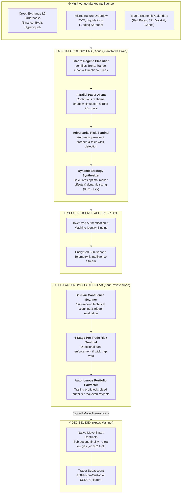
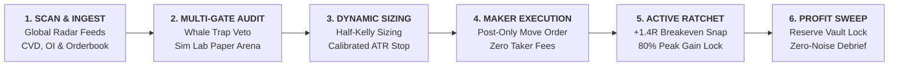

# Alpha Autonomous Client V3 (Decibel DEX • Aptos Mainnet)

[](https://aptoslabs.com)
[](https://decibel.exchange)
[](https://nodejs.org)
[](https://www.docker.com/)
[](LICENSE)

> **Next-generation autonomous perpetual futures trading client for Decibel DEX on Aptos.**  
> Powered by **Alpha Forge Sim Lab** quantitative intelligence via secure License API Key streaming. 100% Non-Custodial, zero-dependency on-chain Move order execution, 4-stage pre-trade risk sentinels, autonomous trailing profit harvesting, and a 1-minute browser onboarding wizard.

---

```
  ┌────────────────────────────────────────────────────────────────────────┐
  │                           EXECUTIVE OVERVIEW                           │
  │                                                                        │
  │  Target Product   : Alpha Autonomous Client V3                         │
  │  Intelligence Hub : Alpha Forge Sim Lab (Cloud Quantitative Engine)    │
  │  Access Model     : License API Key (Direct Telemetry Stream)          │
  │  Execution Venue  : Decibel DEX • Aptos Mainnet                        │
  │  Custody Model    : 100% Non-Custodial (Your Wallet, Your Subaccount)  │
  └────────────────────────────────────────────────────────────────────────┘
```

---

## Executive Summary

**Alpha Autonomous Client V3** represents a paradigm shift in decentralized algorithmic trading. Designed specifically for quantitative funds, proprietary trading desks, and serious decentralized finance (DeFi) traders, Client V3 pairs **non-custodial on-chain execution speed** with the computational firepower of **Alpha Forge Sim Lab**—a high-frequency cloud research and simulation laboratory.

Traditional retail trading bots operate in a complete vacuum: they rely on lagged chart indicators, fail during sudden market regime shifts, and suffer catastrophic drawdowns from toxic order flow. Centralized hedge funds, conversely, demand full custody of your capital.

**Client V3 solves both problems simultaneously:**
1. **Zero Custody Risk:** You deploy Client V3 inside your own private environment (Docker container, private VPS, or dedicated local hardware). Your private keys, subaccounts, and collateral never leave your sovereign control.
2. **Institutional Quantitative Brain:** Through a cryptographically authenticated **License API Key**, your private Client V3 terminal links directly into **Alpha Forge Sim Lab**. Sim Lab continuously streams real-time macro regimes, multi-venue orderflow intelligence, parallel paper simulation vetoes, and dynamic risk parameters directly to your execution engine.

---

## 🏛️ Ecosystem Architecture

<p align="center">
  
  <br>
  <em>Figure 1: High-level architectural overview of the Alpha Forge Sim Lab quantitative core streaming intelligence through an encrypted License API Key bridge to sovereign Client V3 execution nodes on Aptos Mainnet.</em>
</p>

---

## 👥 Agent Fleet Organizational Structure (The Institutional Staff Hierarchy)

To understand how the entire system operates 24/7 without emotional bias or human fatigue, think of it as an **institutional quantitative trading firm**. Rather than a monolithic black-box bot, the system is organized into a disciplined **human-style staff hierarchy** consisting of four operational tiers:

```
┌────────────────────────────────────────────────────────────────────────┐
│                        TIER 1: THE AGENT BRAIN                         │
│             Executive High Command • Chief Investment Officer          │
└───────────────────────────────────┬────────────────────────────────────┘
                                    │ Directs Portfolio Mandate
                                    ▼
┌────────────────────────────────────────────────────────────────────────┐
│                    TIER 2: SPECIALIZED AGENT OFFICERS                  │
│       Department Heads: Macro, Microstructure, Risk, & Harvest        │
└───────────────────────────────────┬────────────────────────────────────┘
                                    │ Allocates Operational Directives
                                    ▼
┌────────────────────────────────────────────────────────────────────────┐
│                  TIER 3: OPERATIONAL PROCESSING NODES                  │
│       Physical Stations: Sim Lab Cloud, Edge Execution, Client Terminal│
└───────────────────────────────────┬────────────────────────────────────┘
                                    │ Deploys to Factory Floors
                                    ▼
┌────────────────────────────────────────────────────────────────────────┐
│                 TIER 4: NODE FUNCTIONS & DEDICATED WORKERS             │
│        The Task Force: Streamers, Evaluators, Sentinels, & Sweepers    │
└────────────────────────────────────────────────────────────────────────┘
```

### 🧠 Tier 1: The Executive Brain (Chief Investment Officer & High Command)
* **Who It Is:** The top-level executive intelligence synthesizing macro insights, overall portfolio mandates, and inter-agent consensus.
* **Core Mission:** Answers the primary strategic question: *"What is the overarching market regime today, and are we in capital preservation or aggressive capital deployment mode?"*
* **Staff Responsibility:** Continuously balances long vs. short exposure across the entire fleet, sets the global confidence hurdle, and coordinates the specialized departmental officers below.

---

### 👔 Tier 2: Specialized Agent Officers (The Department Heads)

Just like senior partners at a quantitative hedge fund, four dedicated Agent Officers oversee specialized domains:

1. **The Macro Regime & Strategy Officer (The Strategist):**
   * **Role:** Analyzes global market weather across crypto and TradFi (Bitcoin dominance, macro liquidity, interest rates, scheduled news events).
   * **Duty:** Issues directional bans (e.g., banning Longs during distribution waterfalls), establishes trade confidence thresholds (e.g., 70% in trend vs. 85% in chop), and selects active strategy playbooks.

2. **The Microstructure & Orderflow Officer (The Tape Reader):**
   * **Role:** Analyzes sub-second multi-venue orderbook depth, Cumulative Volume Delta (CVD), Open Interest (OI) velocity, and liquidation clusters.
   * **Duty:** Detects institutional footprints—spotting whether aggressive wicks are genuine breakouts or predatory stop-loss hunts—before any order is drafted.

3. **The Risk Sentinel & Capital Officer (The Guardian):**
   * **Role:** The immutable defense sentinel holding ultimate veto power over every proposed trade.
   * **Duty:** Enforces fractional Half-Kelly sizing, maximum leverage caps (5x to 10x), strict position budget allocations, and triggers the mandatory 30-minute freeze prior to major macroeconomic data releases (CPI/FOMC).

4. **The Portfolio Harvester Officer (The Exit Master):**
   * **Role:** Manages the active life cycle of open positions once they are live on-chain.
   * **Duty:** Dynamically calculates Take-Profit hurdles using 15-minute ATR and Volume Profile Point of Control (POC), ratchets stop-losses to an institutional 0.75% breakeven buffer once +1.4R is achieved, trails winners to capture big trends, and cuts stagnant positions before they bleed.

---

### 🏢 Tier 3: Operational Processing Nodes (The Physical Stations)

The intelligence and execution responsibilities are cleanly divided across three physical processing nodes:

1. **Node Alpha: The Sim Lab Cloud Research Node:**
   * **Location:** Cloud / Research Cluster (`alpha-forge-server`).
   * **Function:** The 24/7 analytical factory. Continuously runs parallel shadow simulations across 28+ perpetual markets, runs counterfactual backtests, trains neural models, and broadcasts unified Alpha Directives to licensed clients.

2. **Node Beta: The Dedicated Edge Execution Node:**
   * **Location:** Dedicated 24/7 Execution Hardware.
   * **Function:** Colocated low-latency execution node running in isolated Docker containers with local AI models. Executes trades with millisecond precision and zero desktop OS interruption.

3. **Node Gamma: The Client Sovereign Terminal & Operator Node:**
   * **Location:** The Trader’s Local Workstation / Private Browser Dashboard.
   * **Function:** Houses non-custodial cryptographic keys, manages local subaccount credentials, and provides the trader with real-time portfolio visualization, emergency stops, and parameter overrides.

---

### ⚙️ Tier 4: Node Functions & Dedicated Workers (The Operational Workforce)

Inside each operational node sits a specialized workforce of background workers executing atomic duties around the clock:

#### **Workers Inside the Edge Execution Node (Client V3):**
* 📡 **Market Streamer Worker:** Continuously ingests sub-second WebSockets for mark prices, index prices, and orderbook changes from Decibel DEX on Aptos.
* 🔍 **Confluence Evaluator Worker:** Audits live price action against the active strategy criteria every 500 milliseconds to find high-probability trade setups.
* 🛡️ **Pre-Trade Gatekeeper Worker:** Intercepts every draft order. Checks if the side is banned, validates margin limits, confirms candle wick tolerances, and stops any invalid trade.
* ✍️ **On-Chain Move Executor Worker:** Cryptographically signs transactions using the trader’s local private key and submits Post-Only Maker limit orders with zero slippage and ultra-low gas (<0.002 APT).
* 🌾 **Dynamic Harvester & Ratchet Worker:** Evaluates open positions every second. Calculates dynamic ATR volatility bands, snaps stop-losses to +0.75% breakeven cushion once in profit, and trails winning runners.
* 📊 **Telemetry Feeder Worker:** Reports anonymized execution metrics, slippage data, and win/loss statistics back to Sim Lab for continuous reinforcement learning.
* 🐕 **Watchdog Sentry Worker:** Constantly monitors container memory, network sockets, and database locks, auto-reconnecting or recovering state if an RPC endpoint glitches.

#### **Workers Inside the Sim Lab Node:**
* 🌐 **Multi-Venue Ingestion Worker:** Streams depth and CVD from Binance, Bybit, OKX, and Hyperliquid.
* 🥊 **Parallel Paper Arena Worker:** Simulates trades across all 28 pairs simultaneously to test strategy candidates in live conditions.
* 🧪 **Stress Inoculator Worker:** Simulates flash crashes and liquidity drains to verify that strategy gates properly protect capital.
* 🔑 **License & Fleet Key Dispatch Worker:** Securely encrypts and dispatches Alpha Bundles to authorized client nodes.

---

## 🔄 End-to-End System Flow

The diagram below illustrates how raw multi-venue market data transforms into hardened on-chain profit execution across the decentralized ecosystem:



---

## 🔬 The Core Advantage: Alpha Forge Sim Lab

Why is Sim Lab essential to institutional performance? In high-frequency and automated derivatives trading, executing trades without continuous simulation is financial suicide. 

### 1. Continuous Parallel Paper Arena
Sim Lab runs non-stop shadow simulations across 28+ perpetual pairs simultaneously. It evaluates market entry setups against historical and real-time counterfactual conditions:
* If a strategy candidate's shadow win rate falls below $35\%$ in current liquidity, Sim Lab issues an immediate **Pre-Trade Veto**.
* Your Client V3 terminal automatically bypasses the losing trade, preserving your capital for high-probability setups.

### 2. Multi-Venue Orderflow Microstructure
Crypto markets move as a unified liquidity fabric. Decibel DEX price action is directly influenced by global taker volume, cumulative volume delta (CVD), and cross-exchange basis.
* Sim Lab ingests real-time depth from Binance, Bybit, and Hyperliquid.
* Detects institutional absorption, iceberg orders, and spoofing before they impact Decibel mark prices.

### 3. Dynamic Volatility & Directional Bans
* **Directional Bans:** During aggressive institutional distribution or markup regimes, Sim Lab locks out counter-trend trades (`bannedSide: 'LONG'` or `bannedSide: 'SHORT'`).
* **Macro Event Freeze:** Sim Lab monitors global macroeconomic shockwaves (FOMC, CPI releases), automatically freezing trade entries 30 minutes prior to high-impact announcements.
* **Dynamic Sizing:** Scales position sizes between `0.5x` (low-liquidity chop) and `1.2x` (high-conviction directional expansion).

---

## ⚡ The Flagship Product: Alpha Autonomous Client V3

**Alpha Autonomous Client V3** is the execution powerhouse deployed by the trader. It is engineered with high resilience, minimal resource footprint, and zero operational friction.

### 🛡️ 100% Non-Custodial Security
* You maintain complete custody of your private keys and trading subaccounts.
* Trades are signed locally and broadcast directly to Aptos Mainnet via native Move contract calls.
* No middleman, no pool deposits, no withdrawal lockups.

### ⏱️ 1-Minute Browser Onboarding
* Zero complex command-line headaches.
* Simply launch Client V3 and open the dedicated browser dashboard (`http://localhost:5050`).
* Built-in setup wizard verifies your Aptos wallet, configures your Decibel subaccount, and performs on-chain gas sentry verification in under 60 seconds.

### 🌾 Autonomous Portfolio Harvester (v3.2.0 Dynamic Engine)
Winning trades are not determined solely by the entry; they are won at the exit. Version 3.2.0 introduces the **Institutional Dynamic Harvest Engine**, completely replacing static hardcoded dollar thresholds with real-time volatility and capital mathematics:
* **15-Minute ATR Volatility Calibration:** Take-profit hurdles dynamically expand during high-volatility moves and contract during tight consolidations, capturing natural market momentum.
* **ADX Regime Multiplier:** Automatically stretches the profit target from `1.05x ATR` during low-trend chop up to `1.8x ATR` during powerful expansion trends.
* **Volume Profile POC Snapping:** Aligns exit targets with High-Volume Point of Control nodes where institutional liquidity naturally concentrates.
* **Capital-Scaled Dynamic Profit Floor:** Eliminates premature micro-penny exits by mathematically scaling dollar profit floors to notional position size (`notional * 0.625%` with a `$0.25` gas floor), ensuring standard positions capture substantive `$1.25` to `$2.80+` gains.
* **Strict Logical Conjunction (`&&`):** Both percentage target AND net dollar hurdles must be satisfied simultaneously before any partial harvest executes.
* **Institutional 0.75% Breakeven Buffer:** Once $+1.4R$ profit is hit, runner stop-losses snap to entry plus a calibrated `+0.75%` fee cushion—protecting trades against exchange spread noise while guaranteeing risk-free runner status.
* **Dynamic Trailing Profit Lock:** Ratchets trailing stop-losses to protect $\ge 80\%$ of peak unrealized gains on mature runners.
* **Defensive Bleed Cutter:** Automatically cuts underperforming or stagnant positions ($\le -3\%$) before adverse drift threatens account margin.

---

## 🔁 The Complete Trading Lifecycle: From Scan to Settlement

How does a trade actually move from raw market noise to locked-in profit? The system treats every position as an asymmetric risk contract governed by a strict 6-stage lifecycle:

<p align="center">
  
  <br>
  <em>Figure 2: The end-to-end autonomous trade execution journey and the multi-layered Volatility Shockwave Shield safeguarding capital against liquidation cascades and news spikes.</em>
</p>



### Stage 1: Continuous Market Radar Scanning
* Streams raw non-candle orderflow (Cumulative Volume Delta, Taker Buy/Sell Ratios, Open Interest velocity) across Binance, Bybit, OKX, and Decibel.
* Continuously scans 28 perpetual pairs simultaneously in sub-second intervals for institutional imbalances.

### Stage 2: Adversarial Multi-Gate Audit
Before any order is drafted, the setup must clear 5 simultaneous validation gates:
1. **Liquidity Trap Lens:** Has an institutional fakeout or absorption wick occurred?
2. **Value Profile Lens:** Is price at an advantageous discount (for Longs) or premium (for Shorts)?
3. **Macro Weather Lens:** Is the market trending or caught in random walk chop?
4. **Counterfactual Paper Veto:** Did Sim Lab's live shadow simulation on this asset achieve $\ge 35\%$ win rate in the last 100 iterations?
5. **Directional Invariant Check:** Enforces that Take-Profit targets mathematically exceed Entry and Stop distances.

### Stage 3: Dynamic Sizing & Risk Floor Calibration
* **Strict Capital Cap:** Risk per trade is strictly capped at $1.0\%$ to $2.0\%$ of available equity—never arbitrary lot sizing.
* **Fractional Half-Kelly Sizing:** Position scale automatically adjusts based on real-time statistical edge ($0.05 \le f^* \le 0.40$).
* **Calibrated Stop-Loss Floor:** Every order is armed with an immutable stop floor $\ge \max(\text{Entry} \times 0.8\%, 1.2 \times \text{ATR})$. No naked trades ever exist.

### Stage 4: Post-Only Maker Execution on Aptos
* Orders are submitted strictly as **Post-Only Maker Limit Orders**, eliminating expensive taker fees and capturing maker rebates.
* Trades are signed natively using the trader's private key directly into Aptos Move smart contracts on Decibel DEX with sub-second settlement and gas costs under $<0.002\text{ APT}$.

### Stage 5: Active Management & Dynamic Trailing Ratchet
Once filled, Client V3’s autonomous pilot actively manages the trade every 500 milliseconds:
* **The +1.4R Breakeven Snap:** As soon as the position gains $+1.4R$ in profit, the stop-loss automatically moves to Breakeven plus fees. The trade can mathematically no longer lose capital.
* **Dynamic Trailing Ratchet:** As profit expands, the stop-loss ratchets upward, locking in $\ge 80\%$ of peak unrealized gains.
* **Defensive Bleed Cutter:** If market momentum stalls and the position drifts to $\le -3.0\%$, the bot terminates the trade early rather than hoping for a turnaround.

### Stage 6: Settlement & Profit Reserve Sweep
* Closed trade PnL is credited directly to the trader’s on-chain subaccount in real-time USDC.
* **25% High-Water Mark Reserve Sweep:** $25\%$ of new peak profits are mathematically cordoned off as protected reserve equity, ensuring previous gains cannot be wiped out by future market turbulence.
* Closed trade telemetry is debriefed into the Sim Lab learning loop to refine tomorrow's parameter weights.

---

## ⚡ How the System Responds to High Volatility & Market Shocks

Retail traders and traditional bots lose their entire accounts during high-volatility events (flash crashes, liquidation cascades, and surprise macroeconomic announcements). **Alpha Autonomous Client V3 is engineered with an institutional Volatility Shockwave Shield:**

```
 ┌────────────────────────────────────────────────────────────────────────────────────────┐
 │                         VOLATILITY SHOCKWAVE SHIELD IN ACTION                          │
 ├───────────────────────────────┬────────────────────────────────────────────────────────┤
 │ MARKET THREAT                 │ AUTONOMOUS CLIENT V3 RESPONSE                          │
 ├───────────────────────────────┼────────────────────────────────────────────────────────┤
 │ High-Impact Economic News     │ 30-Minute Pre-Event Freeze (FOMC, CPI, NFP releases).  │
 │ (e.g. CPI Spikes, Fed Rates)  │ Halts all new entries (`bannedSide: BOTH`).            │
 ├───────────────────────────────┼────────────────────────────────────────────────────────┤
 │ Flash Crash / Cascade Dump    │ Rejection Wick & Waterfall Cascade Shield.             │
 │                               │ Vetoes catching "falling knives" until absorption POC. │
 ├───────────────────────────────┼────────────────────────────────────────────────────────┤
 │ Spread Widening & Slippage    │ Spread & Liquidity Sentry aborts entry if              │
 │                               │ Spread/ATR > 35%, preventing toxic fills.              │
 ├───────────────────────────────┼────────────────────────────────────────────────────────┤
 │ Erratic Low-Liquidity Chop    │ Dynamic Sizing Contraction scales risk down to 0.5x    │
 │                               │ or activates total Sideline Standby.                   │
 ├───────────────────────────────┼────────────────────────────────────────────────────────┤
 │ Sudden Reversal in Open Trade │ Instant Trailing Snap triggers, securing 80% of peak   │
 │                               │ gains or exiting at Breakeven floor.                   │
 └───────────────────────────────┴────────────────────────────────────────────────────────┘
```

1. **Automated 30-Minute Macro Event Lockout:**
   Sim Lab continuously ingests the global economic calendar. Thirty minutes before high-impact events like FOMC interest rate announcements, CPI prints, or Non-Farm Payrolls, the system places the fleet into **Total Entry Lockdown**. No capital is gambled during binary news outcomes.
2. **Dynamic Volatility De-leveraging:**
   When market turbulence surges and the Average True Range (ATR) widens unpredictably, the system automatically shrinks position sizing from standard `1.0x` down to `0.5x` (or moves into complete cash safety). Sizing only expands back to `1.2x` when high-conviction directional clarity returns.
3. **Spread & Liquidity Dislocation Sentry:**
   During market panic, exchange orderbooks frequently thin out, causing catastrophic bid-ask spreads. Client V3 actively tracks the spread-to-ATR ratio. If `Spread / ATR > 35%`, execution is immediately suspended, protecting the trader from toxic slippage.
4. **Zero-Averaging-Down Mandate (Anti-Martingale):**
   The bot never adds to a losing position. Martingale and grid strategies are the primary culprits behind catastrophic account blowups. Client V3 treats every setup as an independent, strictly risk-capped probability event.

---

## 🛡️ Capital Preservation Philosophy: Why Traders Feel Safe

Professional trading desks understand that **capital defense is the prerequisite for compound profitability**. Client V3 is built on four immutable pillars of capital safety:

### 1. Sovereign Non-Custodial Security
You never hand your funds over to an unregulated entity or opaque black box. Your capital resides inside your personal Decibel DEX trading subaccount on Aptos Mainnet, accessible only by your private cryptographic keys. You can disconnect or withdraw your capital at any moment.

### 2. Every Position Has an Immutable Parachute
There is no such thing as an unprotected trade in Client V3. Every order is entered with a pre-calculated mathematical Stop-Loss floor. Even in the event of an internet disconnect or local power failure, your stop orders remain active on-chain.

### 3. Asymmetric Profit Harvesting (Ratchets, Not Hopes)
By ratcheting stops to Breakeven at $+1.4R$ and locking in $80\%$ of peak gains on winning runners, the system mathematically shifts the distribution of returns: losses are small and capped, while winning trades are given room to generate asymmetric upside.

### 4. High-Water Mark Equity Sweep
To protect long-term gains, the system tracks account High-Water Marks (HWM). When new profit records are reached, $25\%$ is cordoned off into an untouchable profit reserve. Subsequent drawdowns only ever fluctuate against recent surplus, shielding your core starting capital.

---

## 🎯 Configurable Trader Profiles: Tailored to Your Risk Tolerance

Whether managing proprietary desk capital or personal liquidity, Client V3 offers pre-calibrated risk profiles:

| Profile | Target Objective | Sizing Multiplier | AI Confidence Floor | Harvester Mode |
| :--- | :--- | :---: | :---: | :--- |
| **🛡️ Capital Shield** *(Conservative)* | Maximum capital preservation; zero tolerance for drawdowns. | `0.5x` to `0.8x` | $\ge 85\%$ Confidence | Early $+1.0R$ Breakeven Snap, tight 75% profit lock |
| **⚖️ Systematic Alpha** *(Balanced - Recommended)* | Optimal risk-adjusted Sharpe ratio with active trend participation. | `0.8x` to `1.0x` | $\ge 80\%$ Confidence | Standard $+1.4R$ Snap, 80% trailing gain ratchet |
| **🚀 Momentum Flow** *(Aggressive)* | Captures high-velocity expansion moves across all 28 pairs. | `1.0x` to `1.2x` | $\ge 75\%$ Confidence | Trend-following extended runner profile |

---

## 📊 Feature Comparison: Standalone vs. Sim Lab Supercharged

| Feature Dimension | Standard Unlicensed Client | Client V3 with Sim Lab License Key |
| :--- | :--- | :--- |
| **Custody & Security** | 100% Non-Custodial | 100% Non-Custodial |
| **Supported Markets** | Decibel DEX (Aptos Mainnet) | Decibel DEX (Aptos Mainnet) |
| **Confluence Scanning** | Local basic technical indicators | Full 6-Layer Multi-Venue Matrix |
| **Regime Awareness** | Static parameters (Blind to shifts) | **Dynamic Macro Regime Stream** |
| **Directional Trap Shield** | None (Susceptible to stop-hunts) | **Automated Directional Bans** |
| **Shadow Simulation Veto** | None | **Live Paper Arena Veto (<35% WR)** |
| **Macro Event Protection** | Manual trader intervention | **Autonomous 30m Pre-Event Freeze** |
| **Position Sizing** | Fixed static lot sizes | **Dynamic Volatility Scaling (0.5x–1.2x)** |
| **Maker Spread Optimization** | Static offset | **Real-Time Adaptive Maker Spreads** |
| **Profit Harvester** | Basic take-profit levels | **Institutional Dynamic Ratchet & Bleed Cut** |
| **Firmware & Model Updates** | Manual updates required | **Continuous Cloud Strategy Streaming** |

---

## 🔑 Licensing & Deployment Model

To ensure optimal execution quality and prevent market saturation, **Alpha Autonomous Client V3** is delivered via an **Institutional License API Key**:

```
 ┌──────────────────────┐         ┌──────────────────────┐         ┌──────────────────────┐
 │   1. Acquire License │         │   2. Deploy Client   │         │   3. Activate & Trade│
 │                      │         │                      │         │                      │
 │ • Secure API Key     │ ──────> │ • Docker / VPS / Edge│ ──────> │ • Enter License Key  │
 │ • Machine Identity   │         │ • Connect Aptos Wallet│        │ • Live Supercharged  │
 │   Binding            │         │ • Subaccount Wizard  │         │   Execution Starts   │
 └──────────────────────┘         └──────────────────────┘         └──────────────────────┘
```

1. **Client Deployment:** Deploy your dedicated Client V3 node via standard Docker container or lightweight Node.js service on your choice of infrastructure (Cloud VPS, Mac, Linux, or Jetson Edge hardware).
2. **License Activation:** Input your License API Key into the onboarding wizard or environment file (`SIM_LAB_TOKEN`).
3. **Instant Pairing:** Client V3 initiates an encrypted handshake with Sim Lab, instantly activating institutional-tier strategy directives, risk sentinels, and real-time execution parameters.

---

## 💻 Quick Start & Deployment Options

### Method A: Standalone 1-Click Launchers (Mac & Windows)
* **macOS:** Download `release/alpha-client-v3-macos.zip`, extract, and double-click `start-macos.command`.
* **Windows:** Download `release/alpha-client-v3-windows.zip`, extract, and double-click `start-windows.bat`.
* The dashboard opens automatically at `http://localhost:5050` with the 1-minute onboarding wizard.

### Method B: Docker Deployment (Recommended for Cloud VPS)

```bash
# 1. Clone the repository
git clone https://github.com/Measmonysuon/alpha_autonomouse_v3.git
cd alpha_autonomouse_v3

# 2. Build and launch the container
docker compose up -d --build

# 3. Access your dashboard
open http://localhost:5050
```

### Method C: Native Node.js Deployment (Developers & Quants)

```bash
# 1. Install dependencies
npm install

# 2. Build TypeScript
npm run build

# 3. Start client
npm start
```

---

## 🎯 Target Trader Profiles

* **Proprietary Trading Desks:** Deploy isolated client instances across multiple subaccounts with unified Sim Lab quantitative governance.
* **High-Net-Worth DeFi Traders:** Automate 24/7 perpetual futures trading without relinquishing custody or trusting centralized black boxes.
* **Algorithmic Traders & Quants:** Leverage state-of-the-art microstructure research and machine-learning signals without the overhead of building massive data ingestion clusters from scratch.

---

## 📜 License & Compliance

Distributed under the MIT License. See [LICENSE](LICENSE) for more information.  
*© 2026 Alpha Autonomous Systems. All rights reserved. Non-Custodial Algorithmic Technology.*
